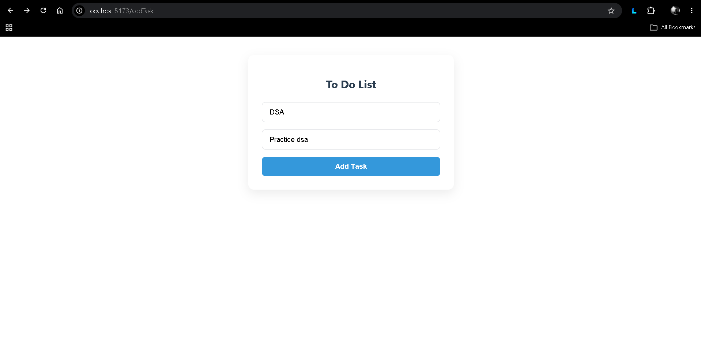

# To Do List App

A full-stack task management application built with React and Node.js. Users can create tasks, view them in a list, and delete tasks when they are completed or no longer needed.

## Screenshots

### Add Task Page



### Tasks Page


## Features

- Add tasks with a title and description.
- View all tasks fetched from MongoDB.
- Delete tasks using their ID.
- Update the task list without refreshing the page.
- Display a message when no tasks are available.
- Store task information in MongoDB.

## Tech Stack

**Frontend**
- React
- Vite
- Axios
- CSS

**Backend**
- Node.js
- Express.js
- MongoDB
- Mongoose

## Project Structure

```text
To_Do Full Stack/
├── Backend/
│   ├── src/
│   │   ├── db/
│   │   ├── models/
│   │   └── app.js
│   ├── server.js
│   ├── package.json
│   └── .gitignore
│
├── Frontend/
│   ├── src/
│   │   ├── pages/
│   │   │   ├── AddTask.jsx
│   │   │   └── Tasks.jsx
│   │   ├── App.jsx
│   │   └── main.jsx
│   ├── package.json
│   └── .gitignore
│
└── README.md
```

## Getting Started

### 1. Clone the repository

```bash
git clone https://github.com/RamitSarker29/Full-Stack-Projects.git
cd "Full-Stack-Projects/To_Do Full Stack"
```

### 2. Backend Setup

```bash
cd Backend
npm install
```

Create a `.env` file inside the `Backend` folder:

```env
PORT=3000
MONGO_URI=your_mongodb_connection_string
```

Start the backend:

```bash
node server.js
```

Backend URL: `http://localhost:3000`

### 3. Frontend Setup

Open another terminal:

```bash
cd "Full-Stack-Projects/To_Do Full Stack/Frontend"
npm install
npm run dev
```

Open the local URL provided by Vite, usually `http://localhost:5173`.

## API Endpoints

| Method | Endpoint | Description |
|---|---|---|
| POST | `/addTask` | Add a new task |
| GET | `/tasks` | Fetch all tasks |
| DELETE | `/tasks/:id` | Delete a task by ID |

## How It Works

1. The user enters a task title and description.
2. Axios sends the task data to the Express backend.
3. Express receives and processes the request.
4. Mongoose stores the task in MongoDB.
5. The Tasks page fetches and displays all stored tasks.
6. Users can delete tasks, and the UI updates without a page refresh.

## Environment Variables

Keep your credentials private. Never upload your `.env` file to GitHub.

Make sure `.env` is included in `.gitignore`.

---

**Author:** Ramit Sarker
